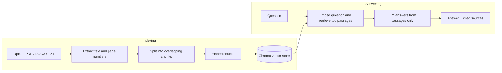

# DocuMind AI

**Ask questions about your documents and get answers you can check.**

DocuMind AI is a full-stack Retrieval-Augmented Generation (RAG) app. Upload PDF, DOCX or TXT files, ask questions in plain language, and every answer comes with the exact passages it was based on, including page numbers for PDFs. If the documents don't contain the answer, it says so instead of guessing.


## Try it in one minute

You only need [Docker Desktop](https://www.docker.com/products/docker-desktop/). No API key and no cost.

```bash
git clone https://github.com/morgy-stack/documind-ai.git
cd documind-ai
docker compose up --build
```

Open **http://localhost:5173**, click **Try sample** to load a sample company handbook, and ask something like *"What is the cancellation policy?"*

Without an API key the app runs in [demo mode](#demo-mode): the full pipeline works offline, but answers quote the most relevant sentences instead of being written by an AI model. Add an OpenAI key for real AI answers (see [Configuration](#configuration)).

## Features

- **Grounded answers with citations.** Answers cite `[Source 1]`, `[Source 2]`… and the UI shows each source passage with its file name and PDF page number.
- **Honest when it doesn't know.** The model is told to answer only from the retrieved passages and to say when they don't contain the answer.
- **Prompt-injection aware.** Document text is passed to the model as untrusted data, and instructions hidden inside a document are ignored.
- **PDF, DOCX and TXT support** with file-type, size and content validation and clear error messages for empty, corrupted or non-UTF-8 files.
- **Knowledge base management:** upload, list and delete documents. Deleting a document also removes its vectors.
- **Offline demo mode** with a bundled sample document, so anyone can try it without an API key.
- **One-command setup** with Docker Compose, plus a tested FastAPI backend.

## How it works



1. **Indexing:** text is extracted (per page for PDFs), split into ~900-character chunks with 150 characters of overlap so sentences at chunk boundaries aren't lost, embedded, and stored in Chroma with its file name, page and chunk ID.
2. **Answering:** the question is embedded, the 5 most similar chunks are retrieved, and the chat model writes an answer using only those chunks, citing which ones it used.

| Layer | Technology |
|---|---|
| Frontend | React 18, TypeScript, Vite, served by nginx in Docker |
| Backend | Python 3.11, FastAPI, Pydantic |
| RAG | LangChain, Chroma (persistent), pypdf, python-docx |
| Models | OpenAI `text-embedding-3-small` and `gpt-4o-mini` (configurable) |
| Infrastructure | Docker Compose |

## Demo mode

Demo mode turns on automatically when `OPENAI_API_KEY` is empty, or when `DEMO_MODE=true`. The UI shows a **Demo mode** badge while it is active. It replaces the two OpenAI calls with offline stand-ins:

- **Embeddings:** a hashed bag-of-words vector, so passages that share words with the question are retrieved.
- **Answers:** the most relevant sentences are quoted with `[Source n]` citations instead of a generated answer.

Everything else (upload, extraction, chunking, Chroma storage, retrieval, citations and deletion) is the same code in both modes. The two modes keep separate indexes, so documents uploaded in one mode must be uploaded again in the other.

## Configuration

To enable real AI answers, create `backend/.env` from the example and add your key:

```bash
cp backend/.env.example backend/.env    # Windows: copy backend\.env.example backend\.env
```

```env
OPENAI_API_KEY=your_key_here
```

Then restart with `docker compose up --build`. **Never commit `.env`.** It is already in `.gitignore`.

| Variable | Default | Description |
|---|---|---|
| `OPENAI_API_KEY` | empty | Enables OpenAI embeddings and answers; empty means demo mode |
| `DEMO_MODE` | `false` | Force demo mode even when a key is set |
| `OPENAI_CHAT_MODEL` | `gpt-4o-mini` | Chat model used for answers |
| `OPENAI_EMBEDDING_MODEL` | `text-embedding-3-small` | Embedding model |
| `CHUNK_SIZE` | `900` | Approximate chunk size in characters |
| `CHUNK_OVERLAP` | `150` | Overlap between adjacent chunks |
| `TOP_K` | `5` | Number of passages retrieved per question |
| `MAX_FILE_SIZE_MB` | `15` | Maximum upload size |
| `CHROMA_PERSIST_DIRECTORY` | `./storage/chroma` | Vector database directory |
| `UPLOAD_DIR` | `./storage/uploads` | Directory for the document list |
| `ALLOWED_ORIGINS` | `http://localhost:5173` | Comma-separated CORS origins |

## Local development without Docker

Requires Python 3.11+ and Node.js 20+.

**Backend** (http://localhost:8000, API docs at http://localhost:8000/docs):

```bash
cd backend
python -m venv .venv
source .venv/bin/activate          # Windows PowerShell: .venv\Scripts\Activate.ps1
pip install -r requirements.txt
uvicorn app.main:app --reload --port 8000
```

**Frontend** (http://localhost:5173), in a second terminal:

```bash
cd frontend
npm install
npm run dev
```

Vite proxies `/api` requests to the backend on port 8000.

## Tests

```bash
cd backend
pytest
```

The suite runs fully offline. It covers the end-to-end flow for TXT, DOCX and PDF files (upload, retrieval, PDF page citations and deletion), rejection of invalid, empty, corrupted and oversized files, demo mode, and the OpenAI code path using test doubles.

## API

| Method | Endpoint | Description |
|---|---|---|
| `GET` | `/api/health` | Service status and mode (`demo` or `openai`) |
| `GET` | `/api/documents` | List indexed documents |
| `POST` | `/api/documents/upload` | Upload and index a file (multipart field `file`) |
| `POST` | `/api/documents/sample` | Index the bundled sample handbook |
| `DELETE` | `/api/documents/{document_id}` | Remove a document and its vectors |
| `POST` | `/api/chat` | Ask a question: `{"question": "..."}` → answer and sources |

Interactive documentation is available at `/docs` when the backend is running.

## Project structure

```text
documind-ai/
├── backend/
│   ├── app/
│   │   ├── api/routes/     # health, documents, chat endpoints
│   │   ├── core/           # settings from environment variables
│   │   ├── rag/            # ingestion, vector store, retrieval, demo mode
│   │   ├── samples/        # bundled sample document
│   │   └── schemas/        # request and response models
│   └── tests/
├── frontend/
│   ├── src/                # React app
│   └── nginx.conf          # serves the app and proxies /api in Docker
├── docs/                   # development and security notes
└── docker-compose.yml
```

## Limitations and roadmap

This is a complete, working project for local use and demonstration. It has not been security-audited, and it is not production-ready without further work.

**Current limitations**

- No user accounts: everyone using an instance shares one knowledge base.
- Scanned PDFs are not supported (there is no OCR), and DOCX tables and images are skipped.
- Each question is answered on its own. Chat history is shown in the browser tab but is not used as context.
- Files are processed during the upload request, so very large files make the upload wait.

**Roadmap**

- Authentication and per-user document collections
- Hybrid keyword + vector search and a reranker for better retrieval
- A RAG evaluation set to measure answer quality
- Background ingestion jobs, OCR, and table extraction
- Rate limiting, upload scanning, monitoring and audit logs

See [docs/SECURITY.md](docs/SECURITY.md) for the security checklist and [docs/DEVELOPMENT.md](docs/DEVELOPMENT.md) for development notes.
