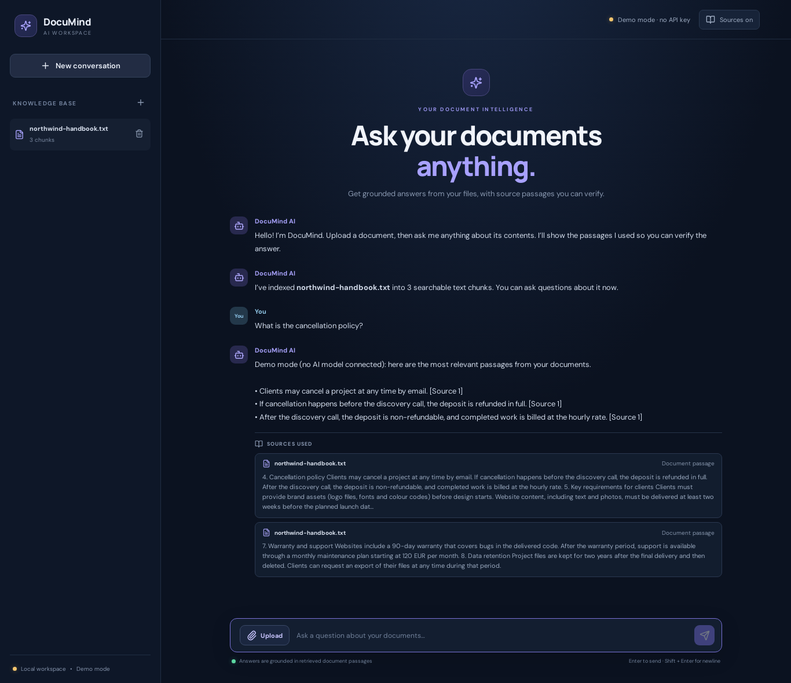
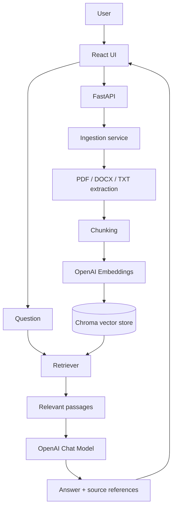

# DocuMind AI — Document-Based RAG Assistant

A portfolio-ready Retrieval-Augmented Generation (RAG) application. Upload PDF, DOCX, and TXT files, index their contents, ask questions in natural language, and inspect the source passages used to answer.



## Try it in one command (no API key needed)

```bash
docker compose up --build
```

Open http://localhost:5173 and click **Try sample** to load a sample handbook, then ask a question.

Without an API key the app runs in **demo mode**: everything works offline and costs nothing, but answers quote the most relevant passages instead of being written by an AI model. Add an OpenAI key (see below) for real AI answers.

## Features

- React + TypeScript chat interface with document upload and source citations
- FastAPI backend with file validation and document ingestion
- Text extraction for PDF, DOCX, and TXT
- Chunking with overlap, OpenAI embeddings, and Chroma vector storage
- Retrieval-augmented answers using an OpenAI chat model
- Source metadata (filename, page where available, chunk)
- Conversation history in the browser session
- Docker Compose setup and API tests
- Configurable model names and retrieval settings
- Offline demo mode with a bundled sample document, so reviewers can try it without an API key

> **Project status:** A complete, working implementation for local demonstration and further hardening. It has not been security-audited and is not production-ready without the additional work listed under [Limitations and next steps](#limitations-and-next-steps).

## Architecture



## Requirements

- Python 3.11+
- Node.js 20+
- Docker Desktop (optional)
- OpenAI API key for AI answers (optional: without one the app runs in demo mode)

## Quick start (local development)

### 1. Backend

```bash
cd backend
python -m venv .venv
# Windows PowerShell:
.venv\Scripts\Activate.ps1
# macOS/Linux:
source .venv/bin/activate

pip install -r requirements.txt
copy .env.example .env  # Windows
# cp .env.example .env  # macOS/Linux
```

Optionally add your API key to `backend/.env` (leave it empty for demo mode):

```env
OPENAI_API_KEY=your_key_here
```

Start the API:

```bash
uvicorn app.main:app --reload --host 0.0.0.0 --port 8000
```

API docs: http://localhost:8000/docs

### 2. Frontend

In another terminal:

```bash
cd frontend
npm install
npm run dev
```

Open http://localhost:5173.

The frontend uses `/api` as its API base and Vite proxies it to `http://localhost:8000`.

## Run with Docker Compose

From the project root:

```bash
cp backend/.env.example backend/.env   # optional: only needed for real AI answers
# Set OPENAI_API_KEY in backend/.env
docker compose up --build
```

Open http://localhost:5173. The API docs are at http://localhost:8000/docs.

## Demo mode

Demo mode turns on automatically when `OPENAI_API_KEY` is empty, or when `DEMO_MODE=true`. It replaces the two OpenAI calls with offline stand-ins:

- **Embeddings:** a hashed bag-of-words vector, so passages sharing words with the question are retrieved.
- **Answers:** the most relevant sentences are quoted with `[Source n]` citations instead of a generated answer.

Upload, chunking, Chroma storage, retrieval, citations and deletion are the same real code in both modes. Demo mode and OpenAI mode keep separate indexes, so documents uploaded in one mode need to be uploaded again in the other. The UI shows a **Demo mode** badge while it is active.

**Never commit your API key.** `backend/.env` is in `.gitignore`. Each person running the project sets their own key, or uses demo mode.

## Environment variables

| Variable | Default | Description |
|---|---|---|
| `OPENAI_API_KEY` | empty | Enables OpenAI embeddings and answers; empty means demo mode |
| `DEMO_MODE` | `false` | Force demo mode even when a key is set |
| `OPENAI_CHAT_MODEL` | `gpt-4o-mini` | Chat completion model |
| `OPENAI_EMBEDDING_MODEL` | `text-embedding-3-small` | Embedding model |
| `CHROMA_PERSIST_DIRECTORY` | `./storage/chroma` | Persistent vector database directory |
| `UPLOAD_DIR` | `./storage/uploads` | Uploaded files |
| `CHUNK_SIZE` | `900` | Approximate chunk size in characters |
| `CHUNK_OVERLAP` | `150` | Overlap between adjacent chunks |
| `TOP_K` | `5` | Number of passages retrieved |
| `MAX_FILE_SIZE_MB` | `15` | Maximum upload size |
| `ALLOWED_ORIGINS` | local Vite origin | Comma-separated CORS origins |

## API overview

- `GET /api/health` — service health and mode (`demo` or `openai`)
- `GET /api/documents` — indexed document list
- `POST /api/documents/upload` — upload and index a document
- `POST /api/documents/sample` — index the bundled sample handbook
- `DELETE /api/documents/{document_id}` — remove a document and its vectors
- `POST /api/chat` — ask a question against the indexed knowledge base

Interactive OpenAPI documentation: `/docs`.

## Example questions

Upload a policy, handbook, product guide, or project specification, then ask:

- "What is the cancellation policy?"
- "Summarize the main responsibilities described in this document."
- "Which section explains the warranty period?"
- "What does the document say about data retention?"

Answers include source passages. If the retrieved context does not contain the answer, the model is instructed to say so.

## Project structure

```text
documind-ai/
├── backend/
│   ├── app/
│   │   ├── api/routes/
│   │   ├── core/
│   │   ├── rag/
│   │   ├── schemas/
│   │   └── main.py
│   ├── tests/
│   ├── requirements.txt
│   ├── Dockerfile
│   └── .env.example
├── frontend/
│   ├── src/
│   ├── package.json
│   ├── Dockerfile
│   └── vite.config.ts
├── docs/
├── docker-compose.yml
└── README.md
```

## Limitations and next steps

This portfolio version is intentionally focused on the core RAG workflow. Before using it with real customers, add:

1. Authentication, authorization, tenant isolation, and per-user document access.
2. Malware scanning, stricter MIME/content validation, rate limits, and upload quotas.
3. Background ingestion jobs for large files and robust retry handling.
4. Hybrid search, reranking, and retrieval evaluation datasets.
5. Observability, audit logs, secrets management, backups, and deployment hardening.
6. Data retention controls and a clear privacy policy.

## Project summary

**DocuMind AI — Intelligent Document Assistant**

Built a full-stack RAG application that enables users to upload PDF, DOCX, and TXT documents and ask natural-language questions about their content. Implemented document parsing, overlapping text chunking, vector embeddings, persistent Chroma storage, semantic retrieval, and LLM-based answer generation with source citations. Developed a React/TypeScript frontend and FastAPI backend, with Docker-based local deployment.

**Core technologies:** Python, FastAPI, React, TypeScript, OpenAI API, LangChain, ChromaDB, Docker.
